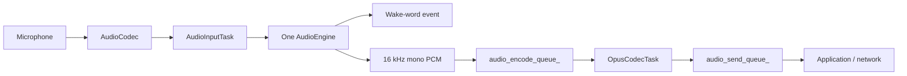

[English](/main/audio/README.md) · **简体中文**

# 音频服务架构

`AudioService` 统一持有一个输入引擎，把编解码 I/O、Opus 编解码与网络队列
和具体芯片的语音流水线解耦。

## 输入引擎

旧的 `AudioProcessor + WakeWord` 组合已被统一的 `AudioEngine` 接口取代。
`AudioInputTask` 只读一次 PCM，并只喂给一个引擎。

| 芯片 | 引擎 | 唤醒词 | 上行处理 |
| --- | --- | --- | --- |
| ESP32-S3 / ESP32-P4 / ESP32-S31 | `AfeAudioEngine` | AFE 内置 WakeNet，或由 AFE 输出喂给 MultiNet | 开启音频处理时启用 FD AEC + VAD |
| ESP32 / ESP32-C3 / ESP32-C5 / ESP32-C6 | `LiteAudioEngine` | 配置了单机 WakeNet 时可用 | 裸单声道 PCM |

`AfeAudioEngine` 只持有一个 FD AFE 实例，WakeNet 与语音上行共用该实例，
因此同时开启两者不会创建两条 AFE 流水线。对于自定义 MultiNet 唤醒词，会由
`CustomWakeWord` 接收 AFE fetch 输出；小容量芯片上不会创建 MultiNet。

`AudioService::GetWakeWords()` 返回已初始化引擎支持的短语，与最近一次命中的
短语无关。WakeNet 只列出当前激活的模型；MultiNet 列出带 `wake` 动作的命令的
展示文本。启动成功后，第一个 idle 状态会打开唤醒词检测，并在 idle 界面清理后
用一条助手消息展示这些短语；OLED 与 LCD 上该消息会在 5 秒后移除，超时只移除
匹配的提示，不影响更新的消息与告警。关闭、失败或启动出错都会抑制该提示，
后续的 idle 切换也不会重复弹出。

当前 AFE 配置使用 `FD_LOW_COST` AEC + `AEC_NLP_LEVEL_VERYAGGR`。
项目不带 NSNet 模型，因此 WebRTC/NSNet 降噪被刻意关闭。

开启唤醒词音频上传时，最近两秒的 PCM 保存在单个 64 KB PSRAM 环形缓冲区中。
WakeNet 与 MultiNet 共用同一套缓存实现，编码器一次读取一帧 Opus。这样避免了
早期的按片上 SRAM 分配和临时 PCM 拼接缓冲。

## 输入数据流

### 板级输入布局

内置板级默认单麦克风：不带播放参考为 `M`，编解码器提供播放参考时为 `MR`。
`R` 必须是播放参考采样，而不是第二个麦克风。通道声明必须与编解码器返回的
交织 PCM 一致。

多麦克风输入仍保留给开发者试验；AFE 依旧从编解码器的麦克风与参考数量推导
自己的格式。对于 Box Lite，`BoxAudioCodecLite` 构造函数的最后一个参数是
`microphone_channels`，默认 `1`；显式传 `2` 可以测试开参考的 `MMR`，或不开
参考的 `MM`。`EnableInput()` 与 `Read()` 用这个数量做采集与交织。在
ESP32-S31-Korvo-1 上，开发者可以把板级的 `AUDIO_INPUT_CHANNELS` 从 `1` 改成
`2` 来测试 `MM`；其编解码器没有播放参考。两种实验布局都没有在默认构建中启用。

单麦克风默认并不意味着 ESP-SR FD 不支持双麦克风，也不代表硬件一定能工作。
发布改动前，需在受影响的板级上验证采集、播放、唤醒/VAD、打断、重连以及可用
的 AEC 模式。Box Lite 的软件播放参考还需要单独验证时序与并发。

唤醒词检测与语音处理是同一引擎上的两个独立运行时状态。在 AFE 芯片上，只要
唤醒词检测开启，AEC 就保持工作，让播放参考在设备播放期间仍然可用于唤醒；
在请求设备侧 AEC 的语音处理期间同样保持。

## 输出数据流

## 任务与电源管理

- `AudioInputTask` 读取编解码输入并喂给选中的引擎。
- `AudioOutputTask` 把解码后的 PCM 送到编解码输出。
- `OpusCodecTask` 编码上行 PCM、解码下行数据包。
- `AfeAudioEngine` 在 S3/P4/S31 上有自己的 AFE fetch 任务。

音频电源定时器仍按活动开关编解码 ADC/DAC 通道；本次引擎重构没有改变该策略。

## 队列与分配策略

服务中的队列使用编译期固定容量存储。既有的丢弃、等待与播放排空策略保持不变，
但队列增长不再分配 deque 节点。`AudioTask` 值直接存储，Opus 编码直接写入数据包
负载，不再分配第二个临时输出缓冲。数据包与 PCM 缓冲池只有在目标侧的堆与延迟
测量证明其额外的所有权复杂度值得之后，才应该引入。
