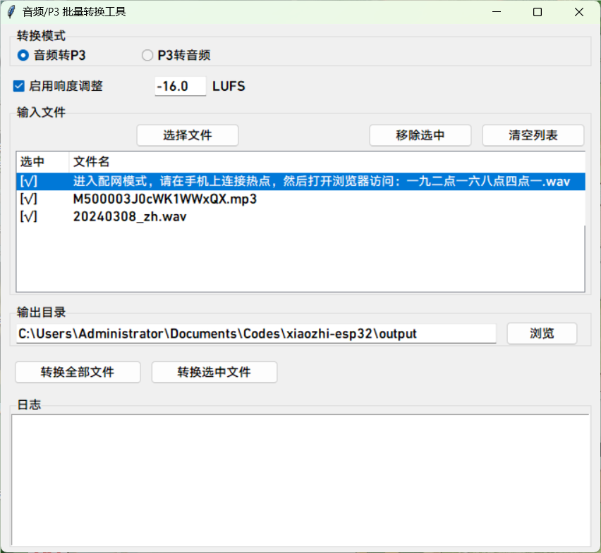

**English** · [简体中文](/scripts/p3_tools/README.zh_CN.md)

# P3 audio conversion and playback tools

This directory holds two Python scripts for working with P3 audio files.

## 1. Audio converter (convert_audio_to_p3.py)

Converts ordinary audio files into the P3 format (4-byte header plus an Opus
packet per frame) with loudness normalisation.

### Usage

```bash
python convert_audio_to_p3.py <input audio> <output p3> [-l LUFS] [-d]
```

`-l` sets the loudness normalisation target, default `-16 LUFS`. `-d` disables
loudness normalisation.

Use `-d` when any of the following applies to the input file:

- The audio is too short
- Its loudness has already been adjusted
- It comes from the default TTS, which already sits at -16 LUFS

Example:

```bash
python convert_audio_to_p3.py input.mp3 output.p3
```

## 2. P3 player (play_p3.py)

Plays P3 audio files.

### Features

- Decodes and plays P3 audio files
- Applies a fade-out when playback ends or is interrupted, to avoid clicks
- Accepts the file to play as a command-line argument

### Usage

```bash
python play_p3.py <p3 file>
```

Example:

```bash
python play_p3.py output.p3
```

## 3. P3 to audio (convert_p3_to_audio.py)

Converts a P3 file back into an ordinary audio file.

### Usage

```bash
python convert_p3_to_audio.py <input p3> <output audio>
```

The output file must carry an extension.

Example:

```bash
python convert_p3_to_audio.py input.p3 output.wav
```

## 4. Batch converter (batch_convert_gui.py)

A graphical tool that batch-converts audio <-> P3.



### Usage

```bash
python batch_convert_gui.py
```

## Dependencies

Install the required Python libraries before using these scripts:

```bash
pip install librosa opuslib numpy tqdm sounddevice pyloudnorm soundfile
```

or use the provided `requirements.txt`:

```bash
pip install -r requirements.txt
```

## P3 format

P3 is a simple streaming audio format:

- Each frame is a 4-byte header followed by one Opus packet
- Header layout: `[1 byte type, 1 byte reserved, 2 byte length]`
- Fixed 16000 Hz sample rate, mono
- 60 ms per frame
